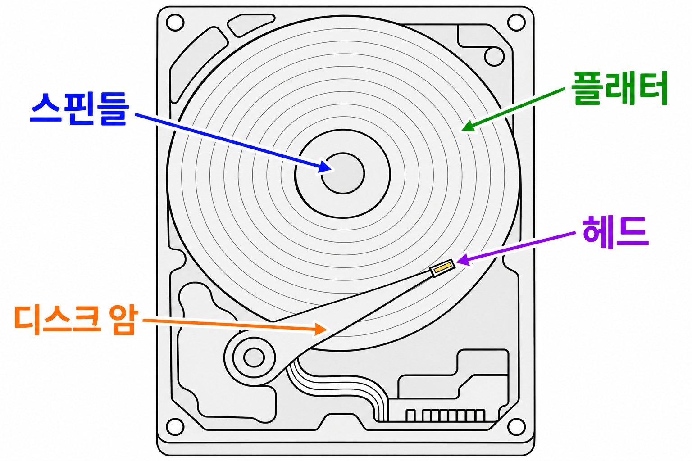
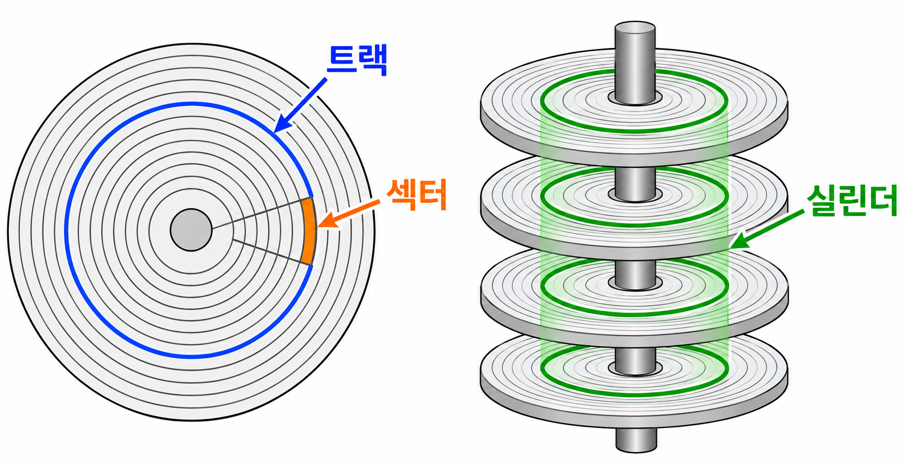
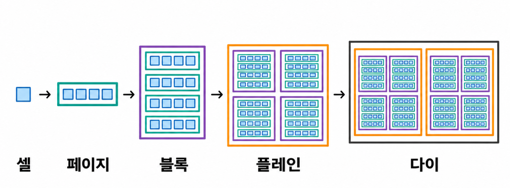
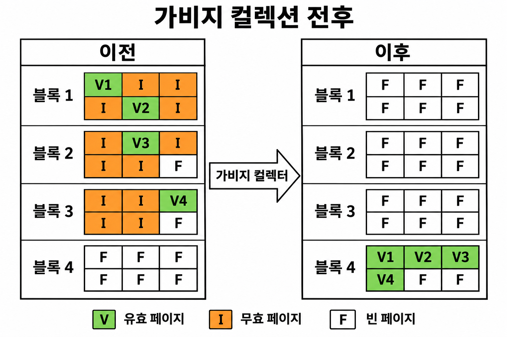

- 작성자: 양사무엘
- 작성일: 2026-11-19

> [!Note]
> 강민철 저자의 『혼자 공부하는 컴퓨터 구조+운영체제』를 바탕으로 학습하고, 이해한 내용을 제 말로 정리한 글입니다.\
> 설명에 오류가 있을 수 있습니다. 잘못된 내용이나 보완할 점을 알려 주시면 확인 후 수정하겠습니다. :)

# 보조기억장치
**보조기억장치**는 프로그램과 데이터를 영구적으로 보관하는 비휘발성 대용량 저장장치이다.

다양한 종류의 보조기억장치가 있지만 그중 가장 대중적인 보조기억장치는 **하드 디스크**와 **플래시 메모리**이다.

## 하드 디스크
하드 디스크는 자기적인 방식으로 데이터를 저장하는 보조기억장치이다.

하드 디스크에서 데이터가 실질적으로 저장되는 곳은 **플래터**이다. 그 플래터를 회전시키는 구성 요소를 **스핀들**이라 한다. 스핀들이 플래터를 돌리는 속도는 분당 회전수를 나타내는 **RPM**이라는 단위로 표현한다.

플래터를 대상으로 데이터를 읽고 쓰는 구성 요소는 **헤드**이다. 헤드는 플래터 위에서 미세하게 떠 있는 채로 데이터를 읽고 쓰는 부품이다. 그리고 헤드는 원하는 위치로 헤드를 이동시키는 **디스크 암**에 부착되어 있다.

### 데이터 저장 단위
플래터는 **트랙**과 **섹터**라는 단위로 데이터를 저장한다. 플래터를 여러 동심원으로 나누었을 때 그중 하나의 원을 트랙이라 부른다. 트랙은 여러 조각으로 나누어지는데, 이 한 조각을 섹터라고 부른다. 섹터는 하드 디스크의 가장 작은 전송 단위이다.

여러 겹의 플래터 상에서 같은 트랙이 위치한 곳을 모아 연결한 논리적 단위를 **실린더**라고 부른다. 연속된 정보는 보통 한 실린더에 기록된다. 그 이유는 디스크 암을 움직이지 않고도 바로 데이터에 접근할 수 있기 때문이다.

### 데이터 접근 시간
하드 디스크가 저장된 데이터에 접근하는 시간은 크게 **탐색 시간, 회전 지연, 전송 시간**으로 나뉜다.

**탐색 시간**은 접근하려는 데이터가 저장된 트랙까지 헤드를 이동시키는 시간을 의미한다.

**회전 지연**은 섹터를 헤드까지 이동시키는 시간을 의미한다.

**전송 시간**은 하드 디스크와 컴퓨터 간에 데이터를 전송하는 시간을 의미한다.

탐색 시간과 회전 지연을 단축시키기 위해서 RPM을 높이는 것도 중요하지만, 접근하려는 데이터가 플래터 혹은 헤드를 조금만 옮겨도 접근할 수 있는 곳에 위치해 있는 것도 중요하다.

> [!Note]
> 플래터의 한 면당 헤드가 하나씩 달려 있는 디스크를 **단일 헤드 디스크**라고 부른다. 반면 헤드가 트랙별로 여러개 달려 있는 하드 디스크는 **다중 헤드 디스크**라고 부른다. 다중 헤드 디스크는 트랙마다 헤드가 있기 때문에 탐색 시간이 0이다.

## 플래시 메모리
**플래시 메모리**는 전기적으로 데이터를 읽고 쓸 수 있는 반도체 기반의 저장 장치이다.

플래시 메모리는 NAND 플래시 메모리와 NOR 플래시 메모리로 나누어지는데 일반적으로 플래시 메모리는 NAND를 의미한다. NAND는 SSD, USB, SD카드 등에 쓰이고 NOR은 펌웨어, 임베디드 코드 저장 용도로 많이 쓰인다.

### 데이터 저장 단위
플래시 메모리에는 **셀**이라는 단위가 있다. 이 셀이 모여 대용량을 갖는 저장 장치가 된다. 이때 이 셀 하나에 몇 비트를 저장할 수 있느냐에 따라 플래시 메모리 종류가 나뉜다. 

- SLC : 한 셀에 1비트를 저장할 수 있는 플래시 메모리 (Single Level Cell)
- MLC : 한 셀에 2비트를 저장할 수 있는 플래시 메모리 (Multiple Level Cell)
- TLC : 한 셀에 3비트를 저장할 수 있는 플래시 메모리 (Triple Level Cell)

> [!Note]
> 플래시 메모리에도 수명이 있다. 한 셀에 데이터를 쓰고 지우고를 일정 횟수 이상 반복하면 그 셀은 더 이상 데이터를 저장할 수 없게 된다.

|구분|SLC 타입|MLC 타입|TLC 타입|
|:---|:---:|:---:|:---:|
|셀당 bit| 1bit | 2bit | 3bit |
|수명| 길다 | 보통 | 짧다 |
|읽기/쓰기 속도 | 빠르다 | 보통 | 느리다 |
|용량 대비 가격 | 높다 | 보통 | 낮다 |

셀들이 모여 만들어진 단위를 페이지, 페이지가 모여 만들어진 단위를 블록이라고 한다. 블록이 모여 플레인, 플레인이 모여 다이가 된다.

### 데이터 접근 방식
플래시 메모리에서 읽기와 쓰기는 페이지 단위로 이루어진다. 하지만 삭제는 페이지보다 큰 블록 단위로 이루어진다. 읽기/쓰기 단위와 삭제 단위가 다르다는 것이 플래시 메모리의 가장 큰 특징 중 하나이다.

페이지는 세 개의 상태를 가질 수 있다. 이는 각각 Free, Valid, Invalid 상태이다.

- Free 상태 :  어떠한 데이터도 저장하고 있지 않아 새로운 데이터를 저장할 수 있는 상태를 의미한다. (모든 전자가 1인 상태)
- Valid 상태 : 이미 유효한 데이터를 저장하고 있는 상태를 의미한다.
- Invalid 상태 : 쓰레기값이라 부르는 유효하지 않은 데이터를 저장하고 있는 상태를 의미한다. 

> [!Note]
> 읽기/쓰기 단위가 다른것과 상태가 3가지인 이유는 플래시 메모리의 물리적 구조를 살펴보면 이해가 쉽다. \
> 기본적으로 한 페이지는 하나의 워드라인(가로배선)에 연결된 셀들이다. 워드라인 하나에만 고전압을 걸면 해당 페이지만 선택해서 쓸 수 있다. 페이지는 1의 상태에서 전자를 넣는 것(1->0)으로 데이터를 쓰기 때문에 덮어쓸 수 없다. \
> 전자를 빼내려면, 즉 지우려면 셀 아래의 기판에 고전압을 걸어야 하는데 한 블록의 셀들은 이 기판을 공유하므로, 전압을 걸면 블록 전체가 한꺼번에 지워진다. 그렇기에 Invalid인 페이지를 하나 지우려고 해도 블록 전체를 지워야 한다.

플래시 메모리에는 가비지 컬렉션 기능이 있다. 블록들의 유효한 페이지들만 새로운 블록으로 복사한 뒤 기존의 블록을 삭제하여 Free 상태로 되돌리는 기능이다.

