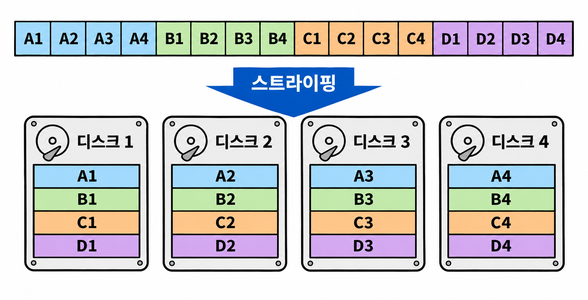
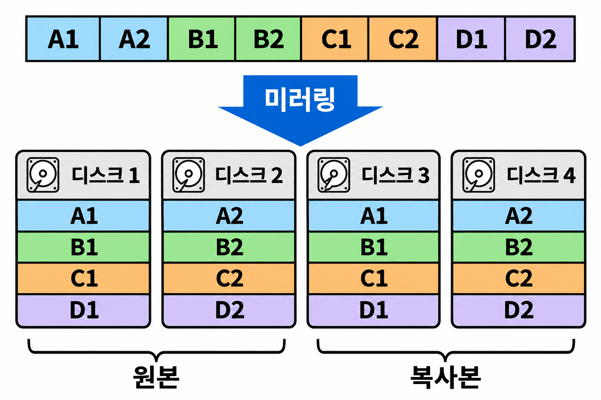
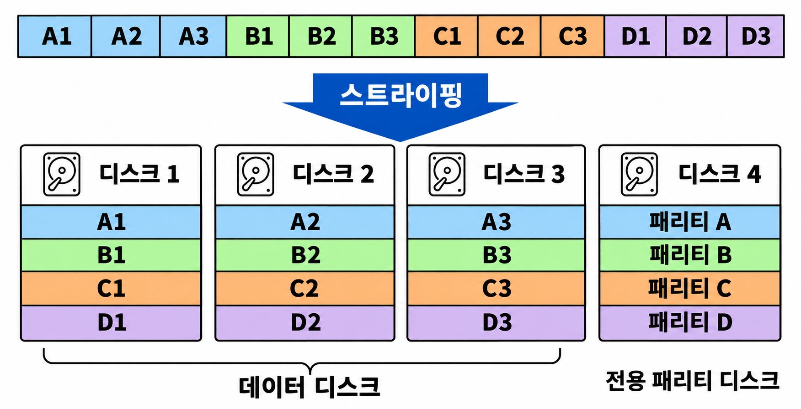
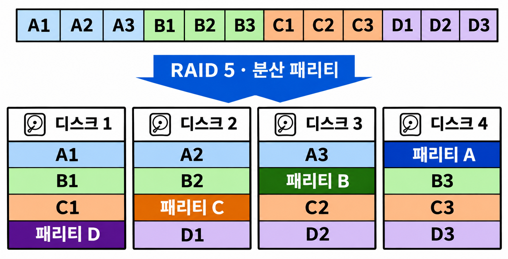
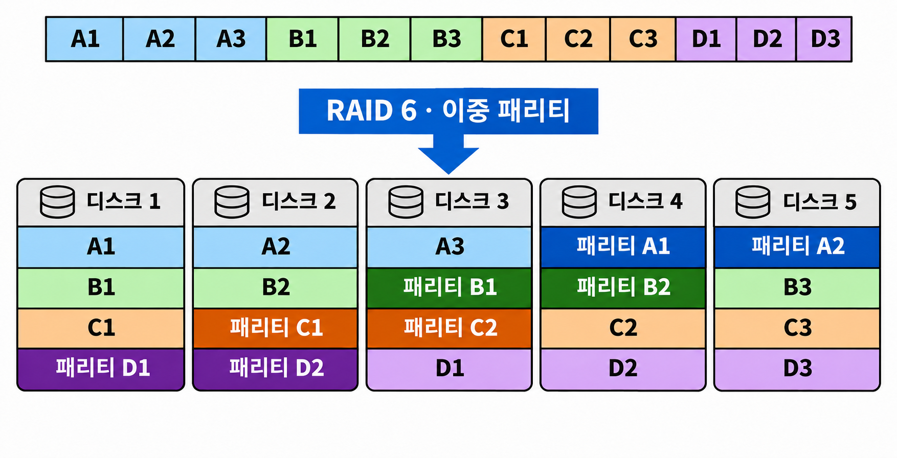

- 작성자: 양사무엘
- 작성일: 2026-11-25

> [!Note]
> 강민철 저자의 『혼자 공부하는 컴퓨터 구조+운영체제』를 바탕으로 학습하고, 이해한 내용을 제 말로 정리한 글입니다.\
> 설명에 오류가 있을 수 있습니다. 잘못된 내용이나 보완할 점을 알려 주시면 확인 후 수정하겠습니다. :)

# RAID
RAID란 데이터의 안전성 혹은 높은 성능을 위해 여러 개의 물리적 보조기억장치를 마치 하나의 논리적 보조기억장치처럼 사용하는 기술을 의미한다.

RAID 구성 방법을 RAID 레벨이라 표현하는데 대표적으로 RAID 0~6이 있고, 그로부터 파생된 RAID 10, RAID 50 등이 있다.

> [!Note]
> RAID 2와 RAID 3은 현재 잘 활용되지 않는다.

### RAID 0 
RAID 0 은 여러개의 보조기억장치에 데이터를 단순히 나누어 저장하는 구성 방식이다. 

이때 마치 줄무늬처럼 분산되어 저장된 데이터를 **스트라입**이라 하고, 분산하여 저장하는 것을 **스트라이핑**이라 한다.

읽고 쓰는 속도가 빠르지만 저장된 정보가 안전하지 않다는 단점이 있다.

### RAID 1
RAID 1은 복사본을 만드는 방식이다. 거울처럼 완전한 복사본을 만드는 구성이기에 **미러링**이라고도 부른다.

복구가 매우 간단하다는 장점이 있지만 쓰기가 느리고 용량이 적어지는 단점이 있다.

### RAID 4
RAID 4는 복사본 대신 오류를 검출하고 복구하기 위한 정보를 저장한 장치를 두는 구성 방식이다.

이때 '오류를 검출하고 복구하기 위한 정보'를 **패리티 비트**라고 한다.

### RAID 5
RAID 4에서 새로운 데이터가 저장될 때마다 패리티를 저장하는 디스크에도 데이터를 쓰게 되므로 패리티를 저장하는 장치에 병목 현상이 발생한다는 문제가 있다. 

RAID 5는 아래 그림처럼 패리티 정보를 분산하여 저장하는 방식으로 RAID 4의 병목 현상을 해소하는 방식이다.

### RAID 6
RAID 6의 기본 구성은 RAID 5와 같지만 서로 다른 두 개의 패리티를 두는 방식이다. 오류를 검출하고 복구할 수 있는 수단이 두개라서 RAID 4나 5보다 안전한 구성이다.

쓰기 속도는 RAID 5보다 느리지만 데이터를 더욱 안전하게 보관할 수 있다.

